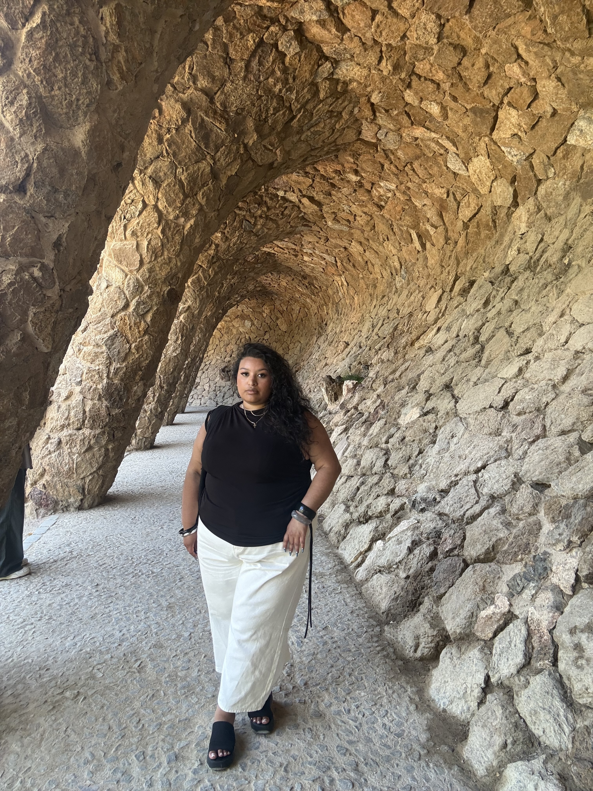
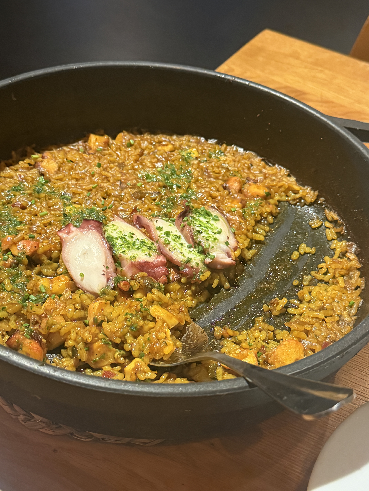
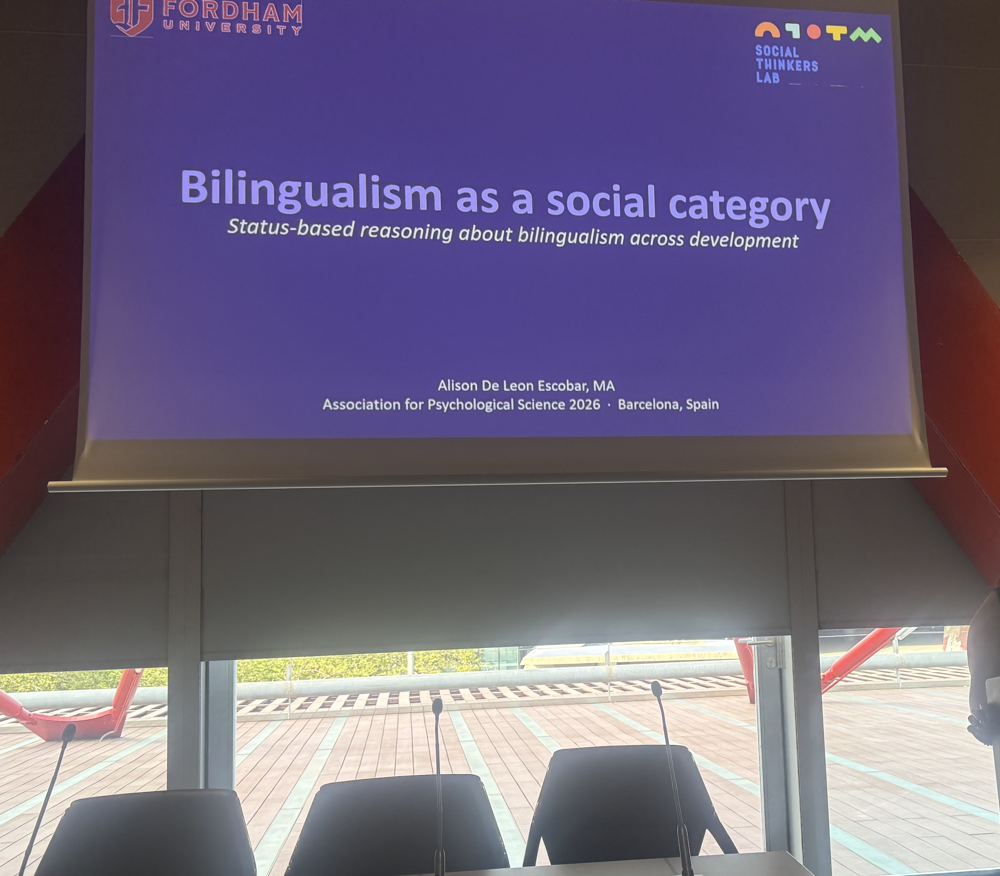
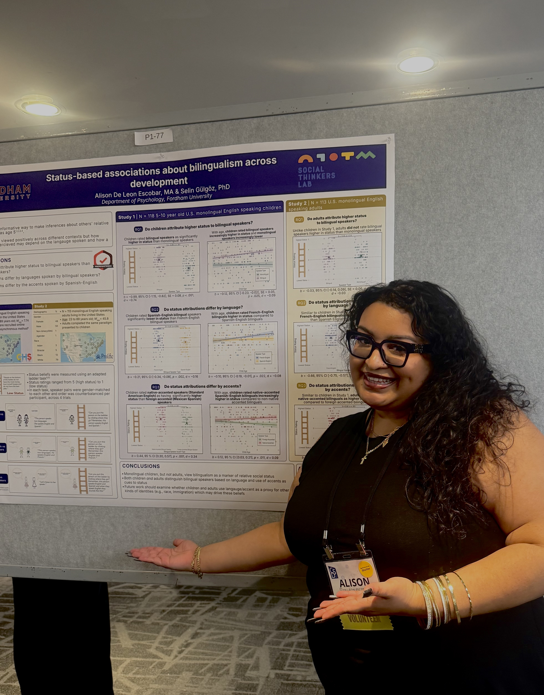
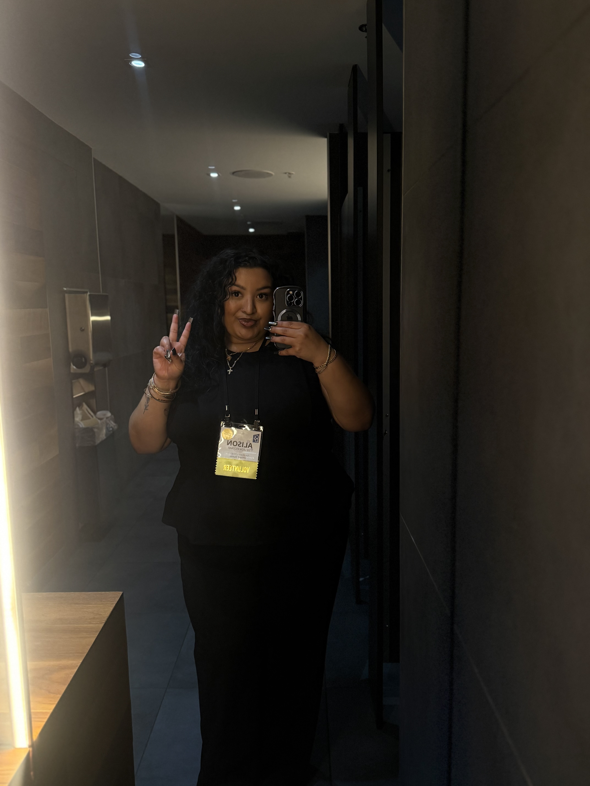
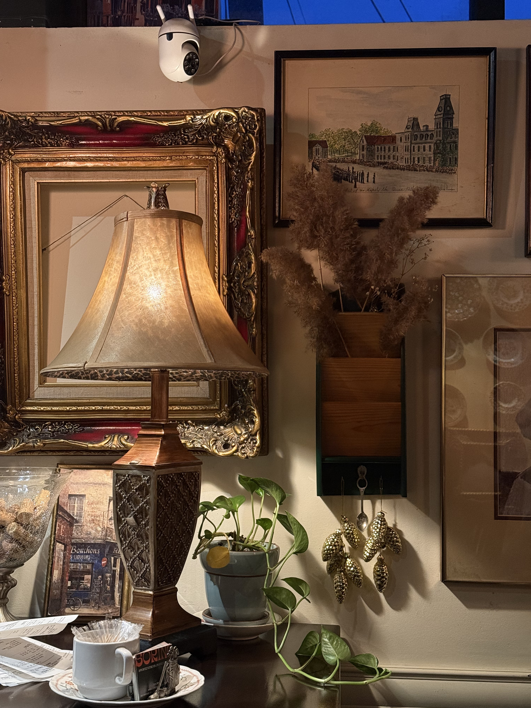
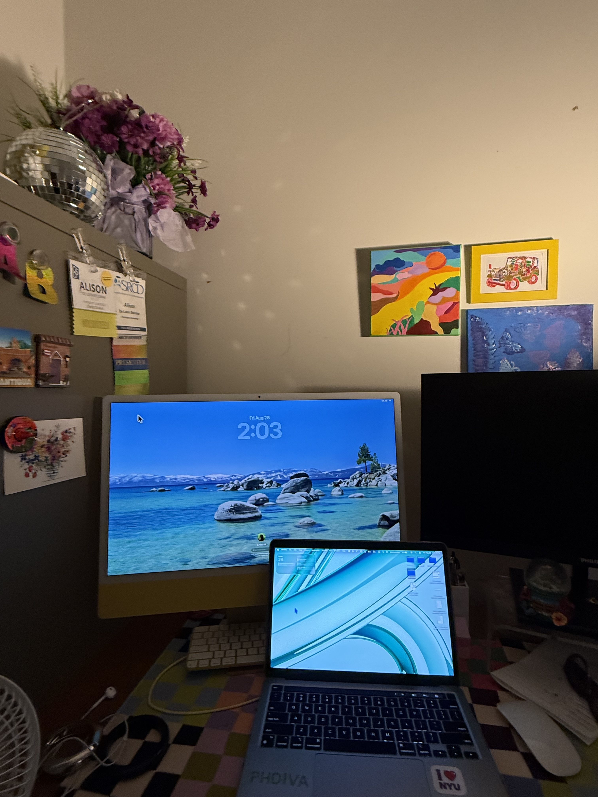
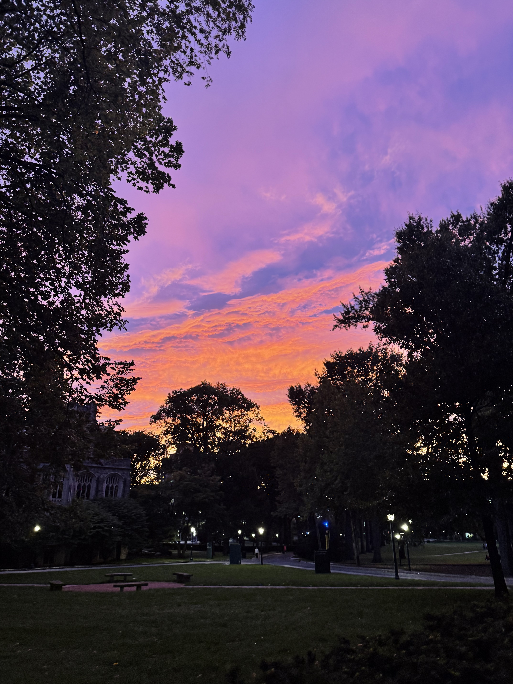

A visual diary of research presentations, academic travel, and the behind-the-scenes reality of my #phdiva journey.

## On the Road: APS Barcelona
*Association for Psychological Science Annual Meeting | May 2026*

::: {layout="[[1, 1], [1]]"}

:::

## On the Road: CDS Montréal
*Cognitive Development Society Biennial Meeting | April 2026*

::: {layout="[[1], [1, 1]]"}

:::

## Behind the Scenes

::: {layout-ncol=2}

:::